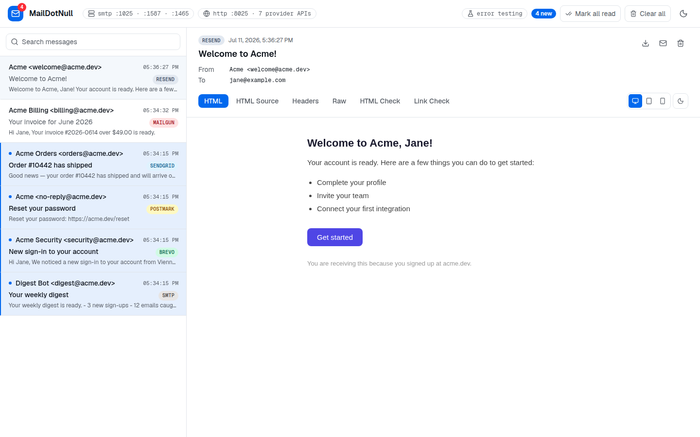
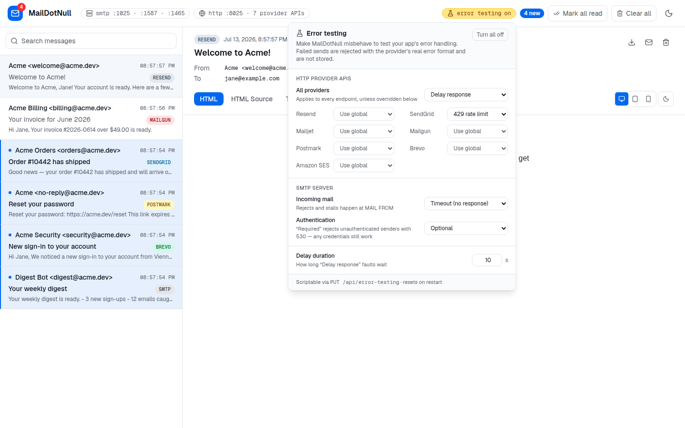

<p align="center">
  
</p>

<h1 align="center">MailDotNull</h1>

<p align="center">
  A local mail catcher that speaks your email provider's API.<br/>
  Nothing is delivered. Nothing is persisted. Any API key works.
</p>

<p align="center">
  <picture>
    <source media="(prefers-color-scheme: dark)" srcset="assets/inbox-dark.png" />
    
  </picture>
</p>

## What it does

MailDotNull is a local mail catcher like [Mailpit](https://mailpit.axllent.org/) — but it also emulates the HTTP send APIs of popular email providers (**Resend, SendGrid, Mailjet, Mailgun, Postmark, Brevo, Amazon SES**) plus plain **SMTP**. Point your app's SDK at MailDotNull instead of the real provider and every message lands in a live web inbox:

- **Provider-faithful responses** — each endpoint returns the provider's real success shape (message IDs, `Queued. Thank you.`, HTTP 202 + `X-Message-Id`, …), so official SDKs treat the send as successful.
- **Live inbox UI** — messages appear instantly (SSE), with HTML preview in a sandboxed iframe, desktop/tablet/mobile widths, light/dark preview, plus HTML Source, Text, Headers, Raw, HTML Check, and Link Check tabs.
- **Error testing** — make any provider (or SMTP) return rate limits, server errors, delays, or timeouts to test your app's error handling.
- **In-memory only** — no database, no files. A restart clears the inbox (that's a feature). Any API key or SMTP credentials are accepted.

## Run it

### Docker

```bash
docker run -d --name maildotnull \
  -p 8025:8025 -p 1025:1025 -p 1587:1587 -p 1465:1465 \
  maildotnull/maildotnull
```

### Podman

```bash
podman run -d --name maildotnull \
  -p 8025:8025 -p 1025:1025 -p 1587:1587 -p 1465:1465 \
  docker.io/maildotnull/maildotnull
```

### From source

```bash
pnpm install
pnpm dev          # or: pnpm build && pnpm start
```

Then open:

- **Web UI + provider APIs**: http://localhost:8025
- **SMTP**: `localhost:1025` (plaintext, no STARTTLS, auth optional, any credentials)
- **SMTP + STARTTLS**: `localhost:1587`
- **SMTPS**: `localhost:1465` (implicit TLS)

Port 1025 never advertises STARTTLS, so clients that upgrade opportunistically (like nodemailer) keep working without TLS config. The certificate on 1587/1465 is self-signed and regenerated in memory on every start, so configure your client to accept it (e.g. nodemailer's `tls: { rejectUnauthorized: false }` — only for pointing at this local catcher, never for real mail servers).

### Send yourself a test message

```bash
curl http://localhost:8025/emails \
  -H "Authorization: Bearer re_anything" \
  -H "Content-Type: application/json" \
  -d '{"from": "Test <test@example.dev>", "to": ["you@example.com"], "subject": "Hello from MailDotNull", "text": "It works!"}'
```

It shows up in the inbox at http://localhost:8025 immediately.

## Connect your services

| Provider | Endpoint | How to point the SDK at MailDotNull |
| --- | --- | --- |
| SMTP | `smtp://localhost:1025` / `:1587` / `:1465` | host `localhost`, port `1025` (plain), `1587` (STARTTLS), or `1465` (TLS) — TLS cert is self-signed |
| Resend | `POST /emails` | `new Resend("re_mock", { baseUrl: "http://localhost:8025" })` |
| SendGrid | `POST /v3/mail/send` | `client.setDefaultRequest("baseUrl", "http://localhost:8025")` |
| Mailjet | `POST /v3.1/send` | `new Mailjet({ apiKey, apiSecret, config: { host: "localhost:8025" } })` |
| Mailgun | `POST /v3/{domain}/messages` | `mailgun.client({ username: "api", key: "mock", url: "http://localhost:8025" })` |
| Postmark | `POST /email`, `POST /email/batch` | `new ServerClient("mock", { requestHost: "localhost:8025", useHttps: false })` |
| Brevo | `POST /v3/smtp/email` | set the SDK base path to `http://localhost:8025/v3` |
| Amazon SES v2 | `POST /v2/email/outbound-emails` | `new SESv2Client({ endpoint: "http://localhost:8025", credentials: { accessKeyId: "mock", secretAccessKey: "mock" } })` |

Responses mimic each provider's success shape so SDKs treat the send as successful. SES supports both `Simple` and raw MIME (`Content.Raw.Data`) payloads.

## Error testing

Make MailDotNull misbehave to test your app's error handling — configure it via the flask button in the header or `PUT /api/error-testing`. A failing send is rejected and not stored; error responses use each provider's real error shape so official SDKs raise their typed errors.

<p align="center">
  <picture>
    <source media="(prefers-color-scheme: dark)" srcset="assets/error-testing-dark.png" />
    
  </picture>
</p>

- `http` — fault for **all** HTTP provider APIs: `off`, `delay` (respond `delaySeconds` late, then succeed), `rate-limit` (429), `server-error` (500), or `timeout` (no response — your client's timeout fires).
- `providers` — per-provider override of `http`: `inherit` (default) or any of the modes above.
- `smtp` — `off`, `delay`, `timeout`, `reject-temporary` (451), or `reject-permanent` (550); applied at `MAIL FROM`.
- `smtpAuth` — `optional` (default) or `required`: when required, unauthenticated senders get `530 Authentication required` (any credentials still succeed).
- `delaySeconds` — how long the `delay` fault waits (1–300, default 10).

Settings reset on restart, like everything else.

## Inbox API

The UI talks to a small internal API you can also script against:

- `GET /api/messages` — list summaries
- `GET /api/messages/:id` — full message (marks it read)
- `GET /api/messages/:id/attachments/:index` — download an attachment
- `PATCH /api/messages` — mark all messages read
- `PATCH /api/messages/:id` — set read state (`{ "read": true | false }`)
- `DELETE /api/messages/:id` — delete one message
- `DELETE /api/messages` — clear the inbox
- `GET /api/events` — server-sent events stream (`change` events)
- `POST /api/link-check` — check `{ "urls": [...] }` and return each URL's HTTP status (used by the Link Check tab)
- `GET /api/error-testing` — current error-testing state
- `PUT /api/error-testing` — partial update, e.g. `{ "http": "rate-limit", "providers": { "resend": "off" }, "smtp": "timeout", "smtpAuth": "required", "delaySeconds": 30 }`

## Configuration

| Variable | Default | Description |
| --- | --- | --- |
| `MAILDOTNULL_SMTP_PORT` | `1025` | Plaintext SMTP port |
| `MAILDOTNULL_STARTTLS_PORT` | `1587` | SMTP port with STARTTLS |
| `MAILDOTNULL_SMTPS_PORT` | `1465` | SMTPS port (implicit TLS) |

The web UI and provider APIs run on port 8025 (fixed via `pnpm dev` / `pnpm start`; remap with Docker's `-p` if needed).

## Notes

- Messages live in memory; a restart clears the inbox. The store keeps the most recent 1000 messages.
- The SMTP server starts from `src/instrumentation.ts`, so it runs with both `pnpm dev` and `pnpm start`.
- HTML bodies render in a fully sandboxed iframe. The preview follows the app theme (with a per-mail light/dark override) and can be viewed at desktop, tablet (768px), and mobile (375px) widths.
- The dark preview simulates real clients — Gmail Android (partial inversion), Gmail iOS (full inversion), Apple Mail (honors the email's `prefers-color-scheme: dark` CSS), Outlook.com (partial inversion), and Yahoo Mail (no color changes) — each with its measured dark-theme background and text colors. The transforms approximate unpublished vendor algorithms; treat results as a close preview, not pixel truth.
- Raw shows the payload exactly as received (MIME for SMTP and SES raw sends, the request body for HTTP APIs); HTML Check flags features known to break in mail clients; Link Check verifies each link's HTTP status on demand.

## Releases

Pushing a `v*` tag triggers `.github/workflows/release.yml`, which builds the Docker image (amd64 + arm64) and pushes it to Docker Hub as `maildotnull/maildotnull:<version>`, `:<major>.<minor>`, and `:latest`. Cut a release with:

```bash
scripts/release.sh 1.2.0
```

The workflow needs two repository secrets: `DOCKERHUB_USERNAME` and `DOCKERHUB_TOKEN` (a Docker Hub access token with read/write scope).

## License

[MIT](LICENSE)
